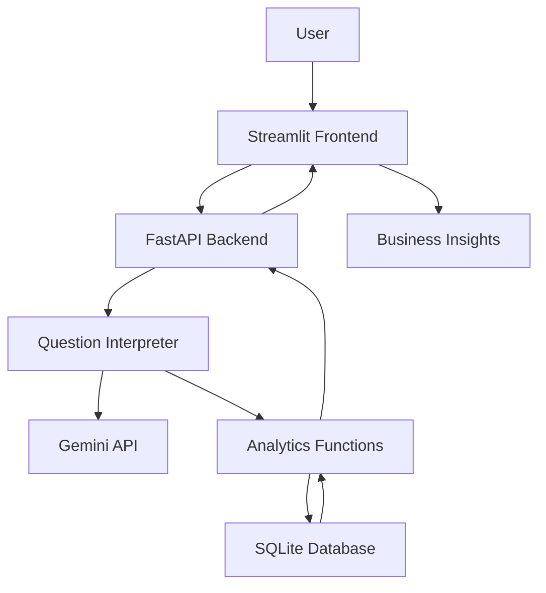

# Mini AI Business Intelligence Assistant

A lightweight AI-powered Business Intelligence Assistant that allows users to ask natural-language questions about sales data and receive meaningful business insights.

The application combines **Gemini for natural-language question interpretation**, **SQL for deterministic analytics**, **FastAPI for backend services**, and **Streamlit for the user interface**.

## Features

- Ask business questions using natural language.
- Interpret user questions using the Gemini API.
- Perform SQL-based analytics on sales data.
- Calculate total revenue, units sold, and monthly revenue.
- Identify top-performing products and regions.
- Analyze revenue by category and sales channel.
- Compare revenue between months.
- Retrieve the list of products available in the dataset.
- Display analytics results through a Streamlit interface.
- Validate analytics logic using automated tests.

## Architecture



### How it works

1. The user enters a business question through the Streamlit interface.
2. Streamlit sends the question to the FastAPI backend.
3. The question interpreter identifies the relevant analytics intent.
4. Gemini is used when rule-based interpretation does not identify the intent.
5. The analytics layer executes the corresponding SQL query.
6. The backend returns the result to Streamlit for display.

**Important:** Gemini interprets the question. The actual numerical analytics are performed using SQL and Python, rather than relying on the LLM to calculate business metrics.

## Tech Stack

| Component | Technology |
|---|---|
| Frontend | Streamlit |
| Backend | FastAPI |
| API Server | Uvicorn |
| Database | SQLite |
| Analytics | SQL, Python |
| AI Integration | Google Gemini API |
| Testing | Pytest |
| Language | Python |

## Dataset

The project uses a sales dataset containing transaction-level information.

Dataset file:

`data/ai_bi_assistant_sales_data - GET.csv`

The dataset contains 51 records and 10 columns:

- Transaction ID
- Order Date
- Product
- Category
- Region
- Sales Channel
- Quantity
- Unit Price
- Discount Amount
- Status

The analytics layer applies revenue-related conditions to ensure that only completed and valid transactions are included in revenue calculations.

## Example Questions

Users can ask questions such as:

- What is the total revenue?
- Which product generated the highest revenue?
- What is the monthly revenue?
- Which region generated the highest revenue?
- Compare January and February revenue.
- How many units were sold?
- What is the revenue by category?
- What is the revenue by sales channel?
- What products are you selling?

## Project Structure

```text
mini-bi-assistant/
│
├── app/
│   ├── __init__.py
│   ├── analytics.py
│   ├── database.py
│   ├── gemini_interpreter.py
│   ├── main.py
│   └── question_interpreter.py
│
├── data/
│   ├── ai_bi_assistant_sales_data - GET.csv
│   └── sales.db
│
├── tests/
│   └── test_analytics.py
│
├── docs/
├── streamlit_app.py
├── requirements.txt
├── .gitignore
└── README.md
```

## Setup and Installation

### Prerequisites

- Python 3.10 or compatible version
- pip
- Google Gemini API key

### 1. Clone the repository

```bash
git clone <YOUR_GITHUB_REPOSITORY_URL>
cd mini-bi-assistant
```

### 2. Create and activate a virtual environment

On Linux:

```bash
python3 -m venv .venv
source .venv/bin/activate
```

### 3. Install dependencies

```bash
pip install -r requirements.txt
```

### 4. Configure the Gemini API key

Create a `.env` file in the project root:

```env
GEMINI_API_KEY=your_gemini_api_key
GEMINI_MODEL=gemini-3.5-flash-lite
```

Replace the placeholder with your own API key.

**Do not commit your `.env` file or expose your API key in the repository.**

## Running the Application

The application has two components: FastAPI backend and Streamlit frontend.

### Start the FastAPI backend

Open a terminal and run:

```bash
uvicorn app.main:app --reload
```

The backend will be available at:

`http://127.0.0.1:8000`

FastAPI interactive API documentation:

`http://127.0.0.1:8000/docs`

### Start the Streamlit frontend

Open a second terminal, activate the virtual environment, and run:

```bash
streamlit run streamlit_app.py
```

Streamlit will provide a local URL, typically:

`http://localhost:8501`

Open the URL in your browser to interact with the application.

## Running Tests

Run the automated analytics tests using:

```bash
pytest -v
```

The tests validate the analytics functionality and help ensure that SQL-based business metrics are calculated correctly.

## Future Improvements

- Improve handling of ambiguous and unsupported questions.
- Add more flexible natural-language analytics.
- Include interactive charts and visualizations.
- Add more datasets and business domains.
- Improve error handling and API response validation.
- Add more automated tests for the question interpretation layer.

## Author

Developed as a Mini AI Business Intelligence Assistant project.